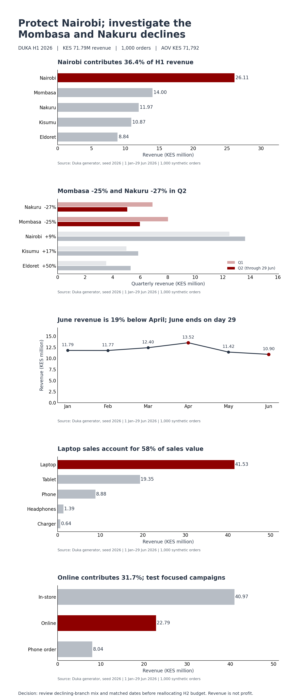

# Student Performance EDA and Duka Board Visual Report

**ADEN AHMED MOHAMED — Cohort 1M DEVIS**

## Two engagements

For the county education office, explore the supplied 1,200-student synthetic cohort, identify support signals and distinguish association from causation. For Duka Electronics, turn the 1,000 synthetic H1 2026 orders into an executive visual story, a chart makeover and prepared dashboard data.

## How to run

Use Python 3.10+ and Jupyter in this repository’s root directory:

```bash
python -m pip install -r requirements.txt
python generate_data.py
```

Open **student_eda.ipynb**, restart its kernel and run all cells; then do the same for **board_report.ipynb**. Save the notebooks after execution. The generator preserves the supplied seed-55 student and seed-2026 Duka code; the notebooks also regenerate missing raw files. Each notebook is independent. Generated raw student_performance.csv and duka_sales.csv are ignored by Git; the committed report, figures and dashboard export are regenerated by the notebooks. Jupyter is the notebook application and can be installed separately if needed.

- student_eda.ipynb: five framework steps, score bands, correlations, grouped/joint pivots, fitted trend, findings and limitations.
- board_report.ipynb: storyboard before plotting, before/after makeover and every chart in the five-panel report.
- reports/duka_board_report.png: one-page report with insight titles, units, source and incomplete-period caveat.
- outputs/duka_dashboard_data.csv: 1,000 ISO-dated orders with numeric revenue for a real Looker Studio data source.
- dashboard.md: publication status, exact dashboard specification and filter-validation targets.
- peer_feedback.md: peer-review requirements still awaiting the user’s cohort posts.

## Five key EDA insights

1. 99 of 1,200 learners (8.25%) score below 60 and are classified At Risk.
2. Nairobi has the highest At Risk share at 9.24% (17 of 184), while Mombasa has the largest count at 19.
3. Private-school learners average 76.01 against 70.46 in Public schools, a 5.55-mark association that persists within attendance bands and study-hour quartiles.
4. Study hours correlate with average_score at r=0.704; the fitted slope is 2.117 marks per recorded study hour and R²=0.495, without implying causation.
5. Study hours are right-skewed (skewness 1.17), with median 4.5, mean 5.08 and 29 upper-IQR review candidates, which are retained rather than presumed invalid.

## One-page Duka board report



## Board Summary (150 words)

Duka generated KES 71.79 million from 1,000 orders during the first half of 2026. Nairobi contributed 36.4% of revenue, so protecting its customer base remains important. Mombasa and Nakuru recorded quarterly revenue declines of approximately 25% and 27%, respectively, while the other branches grew. Management should investigate these two branches before shifting additional marketing funds. Laptops supplied 58% of sales value, creating a clear dependence on one product category. Online orders contributed 31.7% of revenue and offer a focused channel for testing campaigns. We recommend checking stock availability, product mix and channel performance in the declining branches, then running small, measurable recovery trials. Compare equivalent dates before judging performance because the generated dataset ends on 29 June and therefore does not cover the complete second quarter. These synthetic sales records show revenue rather than profit, and cannot explain why performance changed or establish the likely return from proposed marketing spending.

## Interpretation and remaining submission requirements

Average scores are not rounded before banding: At Risk <60; Meeting [60,75); Exceeding ≥75. Student IDs are identifiers rather than quantitative predictors. Attendance segments are below 70%, 70–85% inclusive, and above 85%. Study-hour quartiles are based on recorded values, whose daily/weekly interval is unspecified. The trend is descriptive and in-sample; school-type effects are built into the synthetic generator.

The Duka dataset ends on **29 June**, so Q2 is incomplete; compare equal date coverage before interpreting quarter changes. Revenue is not profit. Charts show generated synthetic orders, not actual Duka operational records.

**Not yet complete:** the public Looker Studio report URL, two authentic dashboard screenshots, a cohort-channel report post and written feedback on two actual peers’ reports. dashboard.md and peer_feedback.md record these outstanding items without inventing evidence. Do not treat the repository as a completed assignment until these requirements are satisfied.
