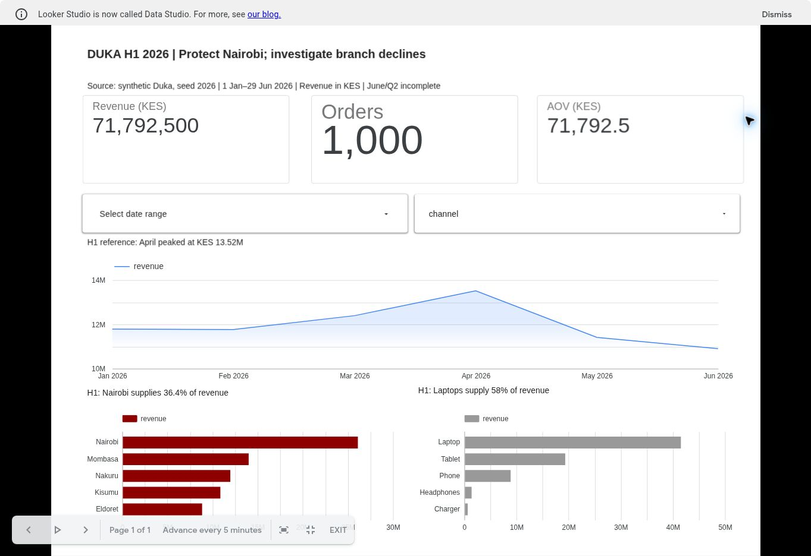
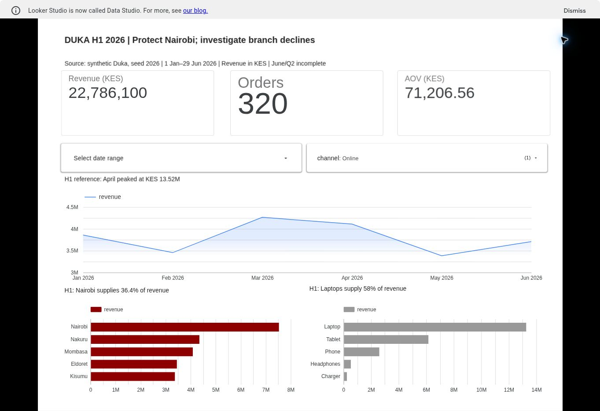

# Duka live dashboard

[Open the public Looker Studio / Data Studio dashboard](https://datastudio.google.com/reporting/6dd044ad-f81e-48ff-a360-67ad0bed26a0/page/t4IEG)

Sharing was saved and checked as **Public — Viewer: anyone on the internet with the link can find and view**. The report contains three scorecards, a monthly revenue trend, sorted branch and product charts, a date-range control and a channel drop-down.

## Data source and calculations

The report uses the native CSV upload connector with `outputs/duka_dashboard_data.csv` (1,000 synthetic orders, seed 2026). This is an uploaded snapshot; regenerate and replace the upload when the input changes. It does not refresh from Google Sheets.

- `Order Date = PARSE_DATE("%Y-%m-%d", order_date)` gives a real Date field; every chart uses it as its date-range dimension.
- Revenue: `SUM(revenue)` in KES.
- Orders: `COUNT_DISTINCT(order_id)`.
- Average order value (AOV): `SUM(revenue) / COUNT_DISTINCT(order_id)` in KES.
- Trend dimension: Order Date at Year Month granularity.
- Branch and product bars: descending total revenue, with zero baselines.

Source and units are printed on the dashboard. H1 reference titles describe the complete input period and remain reference figures when filters are applied. June/Q2 is incomplete because the input ends on 29 June 2026. Branch bars use PLP redberry (#8E0000); product bars use neutral grey.

## Filter validation

| State | Revenue (KES) | Distinct orders | AOV (KES) |
|---|---:|---:|---:|
| All H1 data | 71,792,500 | 1,000 | 71,792.50 |
| Online only | 22,786,100 | 320 | 71,206.56 |
| 1–31 January 2026, all channels | 11,786,600 | 173 | 68,130.64 |

Both controls were tested in the live viewer. Each changed all three scorecards and all three charts; the January trend reduced to one monthly point, and the branch and product scales changed. Reset restored the full H1 totals. Values match the notebook/export; displayed AOV is rounded to two decimals where necessary.

## Authentic dashboard screenshots

Full H1 overview, including scorecards, trend, breakdowns and filter controls:

Online channel selected, showing changed scorecards, trend and branch/product distributions:

These screenshots were captured from the live report viewer, rather than rendered from notebook charts.
